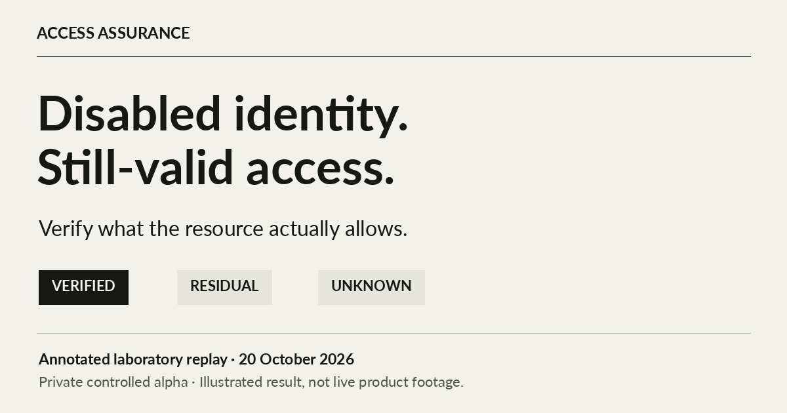

# Access Assurance

**The identity was disabled. Its existing token still worked.**

Access Assurance is a private controlled alpha for planning access removal, authorizing the intervention, and checking what the application actually permits afterward.

[Explore the walkthrough](https://artifexignotvs.github.io/access-assurance/) · [Watch the 90-second illustrated replay](https://artifexignotvs.github.io/access-assurance/assets/recorded-walkthrough.mp4) · [Read the transcript](WALKTHROUGH.md)

This repository presents a recorded laboratory evaluation and its limits. It does not contain the product implementation, an installer, customer data, or a publicly runnable service.

## The recorded scenario

One isolated Keycloak realm. One controlled OIDC application. A test subject and a separate positive-control identity.

| Step | Observed result |
| --- | --- |
| Disable the subject in the identity provider | The application still accepted the original, unexpired JWT. |
| Apply an explicit resource denial | The application denied the subject while the positive control still succeeded. |
| Restore the subject's application access | A fresh observation replaced the prior result with `RESIDUAL`. |
| Make the resource unavailable | A fresh observation produced `UNKNOWN`, not a successful denial. |
| Observe again after recovery | A fresh, time-limited result could be established. Earlier signed history remained available. |

These results were recorded on **20 October 2026**. They describe that run; they do not assert the application's current state.

## What the alpha does

- Plans a bounded intervention over a declared access graph while preserving specified service paths.
- Requires two different approval roles before dispatch and rechecks authority at execution boundaries.
- Records durable intent and execution history; an ambiguous external effect is not blindly retried.
- Compares subject access with a positive control at the configured resource.
- Keeps signed historical evidence separate from expiring current observations.
- Supports authenticated terminal, API, and browser workflows, with isolated encrypted recovery review.

## What the results mean

`VERIFIED` means the configured checks supported denial within their exact scope and validity window. `RESIDUAL` means observed access remained or returned. `UNKNOWN` means the checks could not establish the required result. A signature protects an evidence record under its trust assumptions; it does not make an old observation current.

The evaluation covers one controlled integration. It is not an external security audit, production validation, regulatory certification, or a claim that every access path has been discovered. See [evaluation and limitations](EVALUATION.md).

## Discuss the failure mode

The useful question is concrete: **after revocation, which application can still accept an existing credential?**

Technical feedback about token lifetime, resource enforcement, observation boundaries, and failure handling is welcome through this repository's [issues](https://github.com/artifexignotvs/access-assurance/issues). Use synthetic examples; do not submit credentials, personal data, or internal infrastructure details.

*Acta, non verba.*

## Presentation and rights

The files in `dist/` render this presentation only; they do not implement the access-control engine. The product source, adapters, operational data, and signing material are not distributed. See [rights and reuse](RIGHTS.md).
